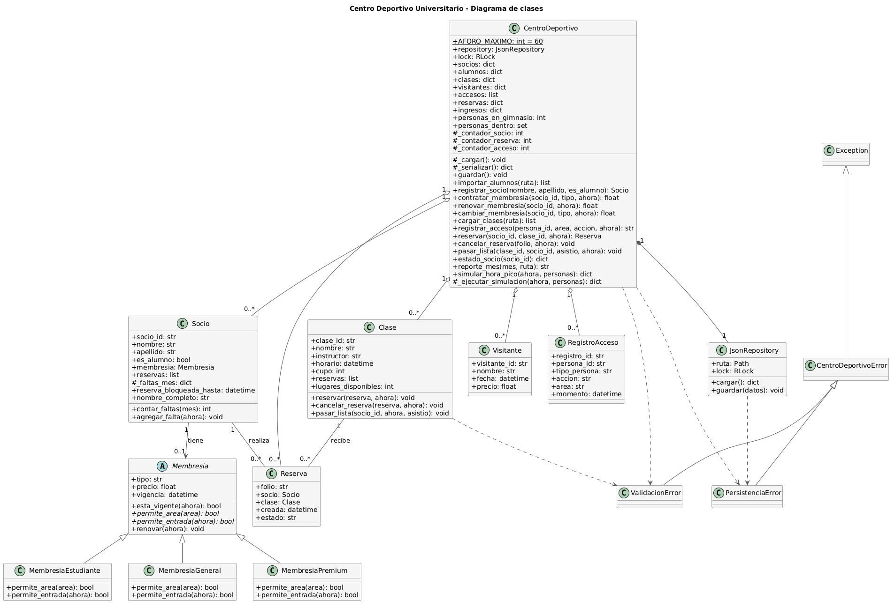

# Documento de diseño

## Centro Deportivo Universitario

Proyecto integrador de Programación Orientada a Objetos.

### Integrantes

- Arellano Sánchez Brandon Gael
- Arteaga Pérez Zabdiel Didier
- Hernández Coronado Andrea Paola
- Juárez Soto Julio César

## 1. Diseño general del sistema

El sistema fue desarrollado en Python utilizando programación orientada a objetos. Se dividió en diferentes módulos para separar las responsabilidades y facilitar el mantenimiento del código.

Las clases del sistema representan elementos del centro deportivo, como socios, membresías, visitantes, clases grupales, reservas y registros de acceso.

La clase CentroDeportivo coordina las operaciones y aplica las reglas necesarias para el funcionamiento del sistema.

La información se conserva mediante archivos JSON y se utilizan archivos CSV para importar alumnos inscritos y clases grupales.

## 2. Diagramas UML

### Diagrama de clases

El diagrama de clases representa la estructura del sistema, sus principales atributos, métodos y relaciones.

Se eligió este diagrama porque permite visualizar la organización de las clases, la jerarquía de membresías y las relaciones entre socios, reservas, clases y registros de acceso.

También permite identificar cómo se distribuyen las responsabilidades dentro del sistema.

## 3. Decisiones de diseño

| Concepto | Dónde se usa | Qué problema resuelve |
| --- | --- | --- |
| Encapsulamiento | Atributos como `_faltas_mes` y los contadores de identificadores de CentroDeportivo. | Organiza el estado interno de los objetos y permite controlar sus modificaciones mediante métodos. |
| Herencia y clases abstractas | Clase Membresia y sus clases hijas MembresiaEstudiante, MembresiaGeneral y MembresiaPremium. | Permite compartir atributos y métodos sin repetir código entre los diferentes planes. |
| Composición y agregación | Relaciones entre CentroDeportivo, socios, clases, membresías y reservas. | Permite organizar objetos relacionados y representar los elementos del centro deportivo. |
| Polimorfismo | Métodos permite_area() y permite_entrada() de las membresías. | Permite aplicar diferentes reglas de acceso dependiendo del tipo de membresía. |
| Excepciones | CentroDeportivoError, ValidacionError y PersistenciaError. | Permite informar errores de validación y almacenamiento sin terminar inesperadamente el programa en los casos controlados. |
| Archivos | Importación de archivos CSV, almacenamiento JSON y reportes TXT. | Permite cargar información, conservar los registros entre ejecuciones y generar reportes. |
| Hilos | Simulación de hora pico mediante threading.Thread. | Permite simular varios torniquetes y solicitudes de reserva concurrentes. |
| Patrones de diseño | Clase JsonRepository, basada en el patrón Repository. | Separa las operaciones de almacenamiento de las reglas del sistema. |

## 4. Alternativas de diseño

### 4.1. Manejo de las membresías

Se consideraron dos opciones:

- Utilizar una sola clase Membresia con condiciones para cada tipo de plan.
- Utilizar una clase abstracta y clases hijas para cada membresía.

Se eligió la segunda opción porque permite que cada tipo de membresía tenga sus propias reglas de acceso y horario, aprovechando la herencia y el polimorfismo.

### 4.2. Almacenamiento de información

Se consideraron dos opciones:

- Guardar toda la información en archivos CSV.
- Utilizar archivos JSON para guardar el estado del sistema y archivos CSV para importar datos.

Se eligió la segunda opción porque JSON permite almacenar estructuras como listas y diccionarios, facilitando la conservación de socios, membresías, reservas y registros de acceso.

Además, CSV permite trabajar fácilmente con los datos de alumnos y clases.

### 4.3. Control de aforo

Se consideró utilizar únicamente un contador de personas dentro del gimnasio. Sin embargo, esto permitía registrar entradas duplicadas y salidas incorrectas.

Se decidió complementar el contador con un conjunto de personas y áreas ocupadas.

El conjunto permite identificar si una persona ya se encuentra dentro de un área y evitar registros duplicados.

### 4.4. Simulación de hora pico

La simulación utiliza hilos para representar operaciones simultáneas.

Se utilizan bloqueos mediante RLock para proteger las operaciones que modifican información compartida, principalmente los accesos y las reservas.

También se decidió ejecutar la simulación utilizando un directorio temporal. De esta manera, los socios, ingresos y registros generados durante la simulación no modifican los datos reales.

La simulación comienza con un gimnasio vacío y utiliza una copia de las clases programadas sin sus reservas reales.

## 5. Reglas y decisiones adicionales

Algunos detalles no estaban definidos completamente en la descripción del proyecto, por lo que se establecieron las siguientes reglas:

- Las membresías mensuales tienen una vigencia de 30 días.
- El pase de visitante tiene vigencia durante el día calendario en que se adquiere.
- Si un visitante regresa otro día, se registra el cobro de un nuevo pase.
- Las salidas pueden registrarse después del horario de cierre.
- No se permiten entradas duplicadas ni salidas sin una entrada previa.
- La importación de un nuevo padrón sustituye al anterior cuando contiene registros válidos.
- Si el padrón no contiene registros válidos, se conserva la información anterior.
- Las clases con identificadores repetidos no se reemplazan, para conservar las reservas existentes.
- Las asistencias y faltas pueden registrarse desde el inicio de la clase.
- El reporte mensual muestra la ocupación del gimnasio al final de cada hora de apertura.

## 6. Validación y pruebas

Para comprobar el funcionamiento del sistema se utilizó unittest, una herramienta de pruebas unitarias incluida en la biblioteca estándar de Python.

Durante el desarrollo se realizaron pruebas para verificar:

- Contratación y renovación de membresías.
- Validación de alumnos inscritos.
- Control de horarios y áreas permitidas.
- Límite de aforo.
- Reservas y cancelaciones.
- Registro de asistencia y faltas.
- Suspensión de reservas.
- Manejo de archivos dañados.
- Actualización del padrón de alumnos.
- Importación de clases.
- Generación del reporte mensual.
- Simulación concurrente y aislamiento de sus datos.
- Cobro del pase diario de visitante.

El proyecto cuenta con 25 pruebas unitarias. También se realizaron pruebas manuales desde la terminal para verificar las entradas, salidas, horarios y persistencia de la información.

## 7. Uso de inteligencia artificial

Durante la revisión y mejora del proyecto se utilizó ChatGPT como herramienta de apoyo.

Se solicitó ayuda para identificar errores en el código, revisar el cumplimiento de los requisitos, proponer correcciones, comprender el uso de Git, elaborar pruebas unitarias y organizar la documentación.

Sobretodo eso ultimo, se aprendió a usar Git con este proyecto, y se utilizó la IA para aprender a usar los comandos

## 8. Contribuciones de los integrantes

### Arellano Sánchez Brandon Gael

Creacion de el reposiutorio de Git

### Arteaga Pérez Zabdiel Didier

Bases de código y borrador incicial del proyecto

### Hernández Coronado Andrea Paola

- Reorganización de los archivos y paquetes del proyecto.
- Corrección de las validaciones de horarios.
- Mejora del control de entradas, salidas y aforo.
- Implementación de la persistencia de la ocupación.
- Corrección de las reglas de reservas y asistencia.
- Mejora del reporte mensual.
- Corrección y aislamiento de la simulación concurrente.
- Mejora del manejo de archivos dañados.
- Validación del pase diario de visitante.
- Revisión de las membresías estudiantiles.
- Incorporación y ejecución de pruebas unitarias.
- Documentación del código.
- Actualización del README.
- Elaboración del documento de diseño.
- Registro de modificaciones mediante Git.

### Juárez Soto Julio César

Presentación de canva 
